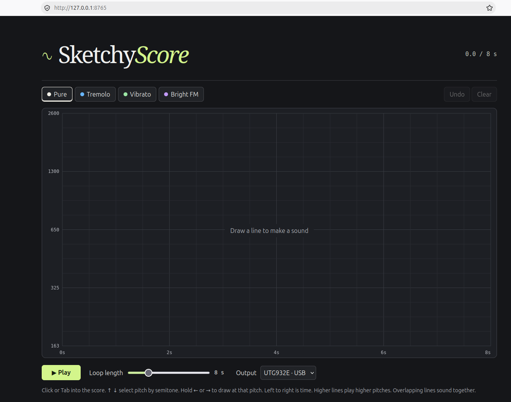

The Bash upic was pretty hacked. Now I have a dual chanel UNI-T UTG932E function generator.
Programed with pyvisa. 
https://pyvisa.readthedocs.io/en/latest/  
https://www.centre-iannis-xenakis.org/cix_upic_presentation?lang=en  

## setup udev
```cmd
 echo 'SUBSYSTEM=="usb", ENV{DEVTYPE}=="usb_device", ATTR{idVendor}=="6656", ATTR{idProduct}=="0834", TAG+="uaccess"' |
  sudo tee /etc/udev/rules.d/70-utg932e.rules
```
## get libraries
```py
python -m pip install pyvisa pyvisa-py pyusb zeroconf
```


## linux dependencies:
```
sudo apt install libusb-1.0-0
```

## run:
```
$ ./bridge.py 
UNI-T Technologies,UTG900E,AWG1225220117,3.06
Open http://127.0.0.1:8765 in your browser. Ctrl-C to quit.

```

## Todo:

- make frq scalable
- make a waveform editor 
- make drawing easier.
- make images saveable / reloadable
- allow svg upload.
- make an andriod app

## video
<a href="https://www.youtube.com/watch?v=3b8PJqtfe9s"> web interface</a>



## Notes: 
Swtiching OFF, produces clicks on the chanels so we avoid that except for turning the 
Function Generator off with  stop button. 

Else, we set the output low, to 0.1 hz to be inaudable, but not trigger the chanel relays.

## Bugs:
frq drop out on shift seems to be a function of this generator. boo.

## debugging:
-> show the pyvisa commands sent  
```trace
$ ./bridge.py --trace
  > :CHANnel1:OUTPut OFF
  > :CHANnel2:OUTPut OFF
[UPIC] UNI-T Technologies,UTG900E,AWG1225220117,3.06
[UPIC] Default: Function Generator
[UPIC] Opening http://127.0.0.1:8765  (Ctrl-C to quit)
  > :CHANnel1:OUTPut OFF
  > :CHANnel2:OUTPut OFF
  > :CHANnel1:OUTPut ON
  > :CHANnel2:OUTPut ON
CH1 leave rest
  before CH1 OUTPut=1 BASE:FREQuency=1.000000e-02 MODe=CONTinue
  > :CHANnel1:BASE:FREQuency 176.2
  after CH1 OUTPut=1 BASE:FREQuency=1.762000e+02 MODe=CONTinue
CH2 leave rest
  before CH2 OUTPut=1 BASE:FREQuency=1.000000e-02 MODe=CONTinue
  > :CHANnel2:BASE:FREQuency 885.8
  after CH2 OUTPut=1 BASE:FREQuency=8.858000e+02 MODe=CONTinue
CH2 enter rest
  before CH2 OUTPut=1 BASE:FREQuency=9.106000e+02 MODe=CONTinue
  > :CHANnel2:BASE:FREQuency 0.01
  after CH2 OUTPut=1 BASE:FREQuency=1.000000e-02 MODe=CONTinue
CH2 leave rest
  before CH2 OUTPut=1 BASE:FREQuency=1.000000e-02 MODe=CONTinue
  > :CHANnel2:BASE:FREQuency 318.3
  after CH2 OUTPut=1 BASE:FREQuency=3.183000e+02 MODe=CONTinue
CH2 enter rest
  before CH2 OUTPut=1 BASE:FREQuency=2.696000e+02 MODe=CONTinue
  > :CHANnel2:BASE:FREQuency 0.01
  after CH2 OUTPut=1 BASE:FREQuency=1.000000e-02 MODe=CONTinue
CH1 enter rest
  before CH1 OUTPut=1 BASE:FREQuency=1.140200e+03 MODe=CONTinue
  > :CHANnel1:BASE:FREQuency 0.01
  after CH1 OUTPut=1 BASE:FREQuency=1.000000e-02 MODe=CONTinue
Browser requested /stop
  > :CHANnel1:OUTPut OFF
  > :CHANnel2:OUTPut OFF

```
